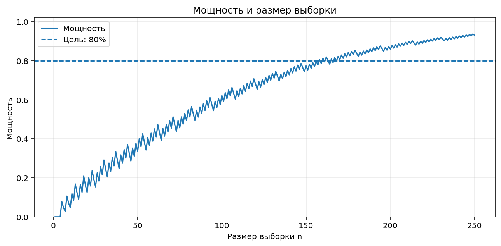
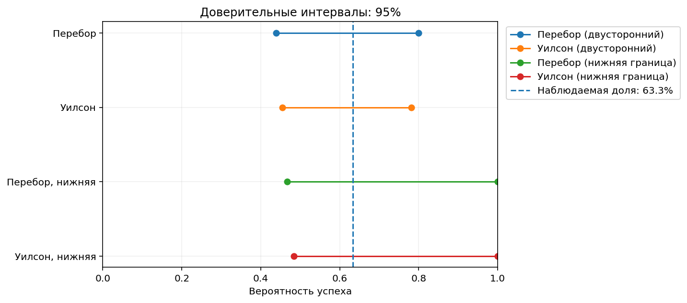
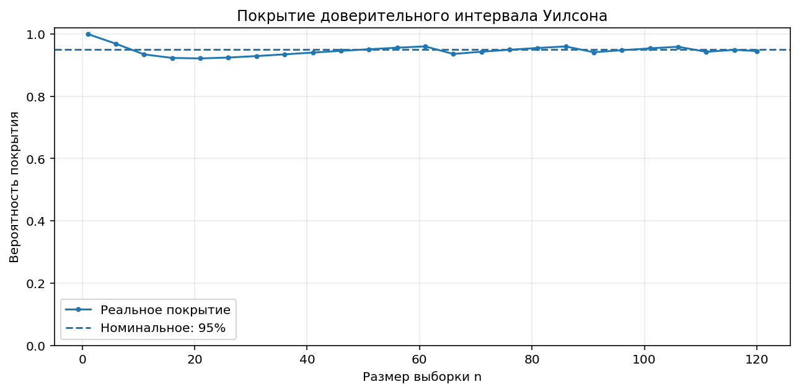

# Мощность · MDE · Размер выборки · Доверительные интервалы

Практические калькуляторы **для одной биномиальной доли** по лекции [«Stat power» Академии аналитиков Авито](https://github.com/avito-tech/applied_statistics/blob/main/Stat%20power.ipynb).

**Как пользоваться:** для мощности и MDE открывай **[`power_mde.ipynb`](./power_mde.ipynb)**; для доверительных интервалов — **[`confidence_intervals.ipynb`](./confidence_intervals.ipynb)**. В каждой записной книжке меняешь только числа под заголовком **ВВОД ДАННЫХ**, запускаешь `Run All` и получаешь результат с графиками.

## Где находится каждый расчёт

| Файл | Зачем нужен | Вводимые параметры | Графики |
|---|---|---|---|
| **[`power_mde.ipynb`](./power_mde.ipynb)** | Интерактивный калькулятор мощности, **MDE** и необходимого размера выборки | `N`, `P0`, `P_ALT`, `ALPHA`, `TARGET_POWER`, `DESIRED_EFFECT` | Распределения H₀/H₁, мощность от `n`, мощность от эффекта с отметкой MDE |
| **[`confidence_intervals.ipynb`](./confidence_intervals.ipynb)** | Интервалы **двумя методами**: перебор гипотез и Уилсон. Также нижние односторонние границы | `N`, `SUCCESSES`, `ALPHA`, `GRID_STEP` | Сравнение интервалов; покрытие интервала Уилсона |
| [`examples.ipynb`](./examples.ipynb) | Обзорный ноутбук: все основные расчёты в одном месте | `PLAN_*`, `CI_*`, `SHOW_PLOTS` | Три обзорных графика |
| [`power_mde.py`](./power_mde.py) | Готовые Python-функции для импорта в другие проекты; можно запускать напрямую | `n`, `p0`, `p_alt`, `alpha`, `target_power`, `mde` | **Да:** функции `plot_*`; прямой запуск `python power_mde.py` строит и сохраняет PNG |
| [`confidence_intervals.py`](./confidence_intervals.py) | Готовые функции вычисления интервалов; можно запускать напрямую | `successes`, `n`, `alpha`, `grid_step`, `side` | **Да:** функции `plot_*`; `python confidence_intervals.py` строит и сохраняет PNG |
| [`figures/`](./figures/) | Уже готовые примеры изображений | Не требуются | PNG открываются прямо в GitHub |
| [`requirements.txt`](./requirements.txt) | Список библиотек | Редактировать не нужно | — |

### Обозначения

- `N`/`n` — количество **независимых** испытаний (одна выборка).
- `P0`/`p0` — конверсия при нулевой гипотезе, например `0.50` = 50%.
- `P_ALT`/`p_alt` — предполагаемая реальная конверсия, например `0.60` = 60%.
- `ALPHA`/`alpha` — уровень значимости (например, `0.05`).
- `TARGET_POWER` — целевая мощность (например, `0.80` = 80%).
- `DESIRED_EFFECT`/`mde` — **абсолютный** прирост конверсии (`0.10` = **+10 процентных пунктов**, а не +10%).
- `SUCCESSES`/`successes` — число успехов из `N` (например, 19 из 30).
- `GRID_STEP` — шаг перебора `p0`, по умолчанию 0.001.
- `SHOW_PLOTS = True` — отображать графики; `False` — только числа.

## Пример результатов из лекции

При `N = 30`, `P0 = 0.50`, `P_ALT = 0.60`, `ALPHA = 0.05`, `TARGET_POWER = 0.80`:

| Задача | Что получаем |
|---|---|
| Мощность | около **29.15%** (вероятность обнаружить 10 п.п. прироста) |
| MDE | **+21.84 п.п.** для желаемой мощности 80% при N=30 |
| Число наблюдений для эффекта +10 п.п. | минимум **158** (одна выборка) |
| Двусторонний 95% интервал перебором (19 успехов из 30) | **43.90–80.00%** |
| Двусторонний 95% интервал Уилсона (19 из 30) | **45.51–78.13%** |

## Графики, которые уже можно открыть

**1. Мощность и размер выборки**



**2. Зависимость мощности от эффекта и положение MDE**


**3. Распределения при H₀ и H₁; критическая область**


**4. Доверительные интервалы двумя методами**



**5. Фактическое покрытие интервала Уилсона**



## Как запустить

**В Jupyter / VS Code:** открой всю папку с файлами, установи зависимости один раз, затем открой нужный `.ipynb` и нажми `Run All`.

```bash
python -m pip install -r requirements.txt
```

**В Google Colab:** загрузи нужный `.ipynb` **и одноимённый `.py`** в доступную рабочую директорию сессии; при необходимости отдельно установи библиотеки. Затем запусти все ячейки. В отличие от GitHub Colab выполняет Python-код.

**В терминале:** можно не открывать ноутбук. Внизу каждого `.py` есть раздел **ВВОД ДАННЫХ** и флаги `SHOW_PLOTS`, `SAVE_PLOTS`. Например:

```bash
python power_mde.py
python confidence_intervals.py
```

При `SAVE_PLOTS=True` рядом с `.py` создаются PNG-файлы — их можно открыть независимо от отображения окон графиков. У `.py` при **импорте** ничего само не запускается.

**Что такое зависимости Python?** `numpy`, `scipy`, `statsmodels`, `matplotlib` — готовые библиотеки для статистических расчётов и графиков. `requirements.txt` — их список, его не нужно редактировать.

## Использование отдельных функций в своём коде

```python
from power_mde import binomial_power, binomial_mde, required_sample_size
from confidence_intervals import ci_by_inversion, ci_wilson

print(binomial_power(n=30, p0=0.5, p_alt=0.6))
print(binomial_mde(n=30, p0=0.5))
print(required_sample_size(p0=0.5, mde=0.1))
print(ci_by_inversion(successes=19, n=30))
print(ci_wilson(successes=19, n=30))
```

## Важные ограничения

1. **Это не расчёт размера групп для стандартного A/B-теста A против B.** Рассматриваем одну биномиальную долю и, для мощности/MDE, правостороннюю альтернативу `H1: p > p0`.
2. Нужны **независимые испытания Бернулли** с одинаковой вероятностью успеха. Множественные действия одного пользователя не всегда независимы.
3. Инверсия по сетке (перебор) использует дискретные гипотезы с шагом `GRID_STEP`: её границы приближённые по сетке. В исходном примере лекции функция имела ошибку: `n` и `alpha` были жёстко записаны как `30` и `0.05`; здесь это исправлено.
4. Метод Уилсона — быстрый приближённый интервал, и при малом `n` его фактическое покрытие может отличаться от заявленных 95%.
5. Для длительного накопления событий и зависимых наблюдений может потребоваться другая статистическая модель. Для двухгруппового A/B-теста — отдельный модуль.

## Происхождение

Основано на материале [Avito Tech «Stat power.ipynb»](https://github.com/avito-tech/applied_statistics/blob/main/Stat%20power.ipynb) (Академия аналитиков Авито). В переработанных функциях сохранены короткие исходные комментарии о критическом значении, мощности, количестве успехов и построении критериев; добавлены удобный ввод значений, графики и корректная обработка параметров.
